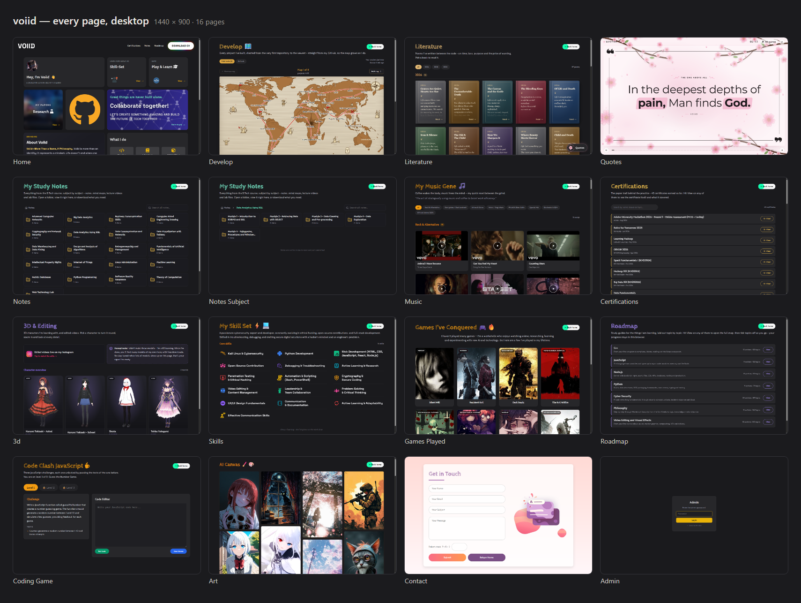
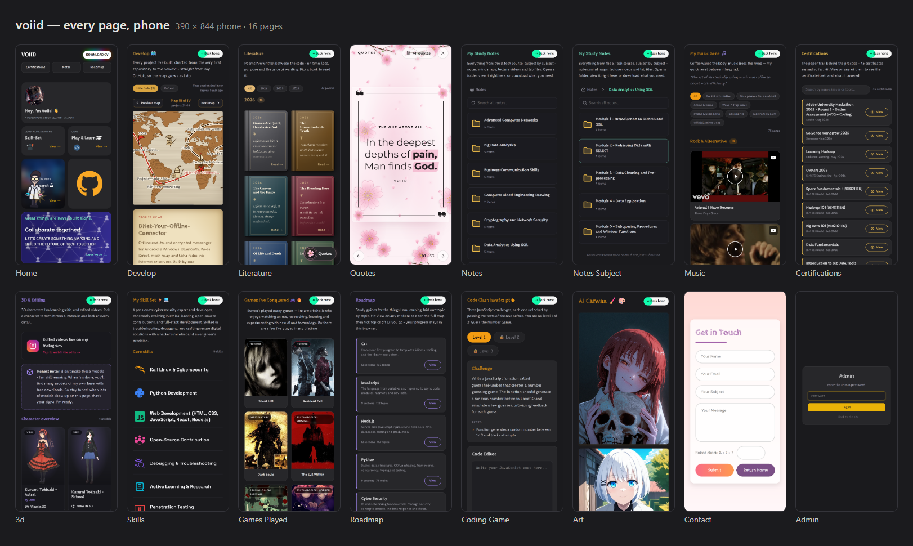

# VOIID

Personal portfolio website of Voiid, a developer and cyber-security student.
Built with React and Vite, with a self-hosted Express backend.

## Features

- Portfolio pages: skills, development projects, art, literature, 3D models, certifications, music, games and learning roadmaps
- Literature: poems plus a Quotes page with a quote of the day
- Develop map of GitHub projects, fetched by the server on a schedule and cached, so visitors never run into GitHub's rate limit
- Notes library with folders, search and in-page PDF, image and video viewing
- 3D model viewer (VRM, GLB, FBX, OBJ)
- JavaScript coding game running in a sandboxed frame
- Contact form with server-side bot protection (no third-party services)
- Admin portal with two-factor authentication, encrypted inbox, content editor and one-click backups (whole site or content only)
- Separate layouts for desktop, mobile portrait and mobile landscape

## Screenshots

Every page on desktop:



Every page on a phone:



Full-size pictures of each page are in [`Gui/`](Gui/).

## Tech Stack

- **Frontend:** React 19, React Router 7, Vite 6, Three.js
- **Backend:** Node.js, Express 4, Helmet, express-rate-limit, archiver (backups)
- **Storage:** Local files, messages and secrets encrypted with AES-256-GCM

## Setup

Requires Node.js 20 or later.

```bash
git clone https://github.com/official-imvoiid/Voiid.git
cd Voiid/Code
npm install
cp .env.example .env
```

Fill in `.env` as described in `.env.example`. Then start the backend and the dev server in separate terminals:

```bash
npm run server
npm run dev
```

The site runs at `http://localhost:5000`.

## Scripts

| Command | Description |
|---------|-------------|
| `npm run dev` | Start the development server |
| `npm run server` | Start the backend |
| `npm run build` | Build for production into `dist/` |
| `npm run preview` | Preview the production build |
| `npm run lint` | Run ESLint |

## Deployment

1. Run `npm run build`.
2. Copy `dist/`, `server.js`, the `server/` folder, `package.json` and `package-lock.json` to the server, then install with `npm ci --omit=dev`.
3. Run `server.js` with `NODE_ENV=production`.
4. Serve `dist/` through a reverse proxy over HTTPS, forwarding `/api`, `/uploads` and `/files` to the backend. Have the proxy add `Strict-Transport-Security`, `X-Content-Type-Options: nosniff` and a `frame-ancestors` policy to the pages, since the backend does not serve them.
5. Set `TRUST_PROXY_HOPS` to the number of proxies in front of the server (usually 1). Wrong values either lock everyone out of the admin after a few failed logins or let visitors fake their address.
6. Optional: add a `GITHUB_TOKEN` to raise GitHub's limit. How often the server checks GitHub is set in the admin under Develop map.

Never commit `.env` or the `data/` directory. `data/` (notes, uploads, 3D models, saved content and the inbox) lives only on the server: copy it there yourself, and keep it safe with the admin's Backup button.

## Security

Please report vulnerabilities privately. See [SECURITY.md](SECURITY.md).

## License

This project is licensed under the [Voiid Personal & Educational License](LICENSE).

- Personal and educational use is permitted.
- Forks and redistribution are permitted, provided the license is kept and the changes made are recorded in `CHANGELOG.md`.
- Pull requests must describe what was changed, in which files and why, and include the matching `CHANGELOG.md` entry.
- Commercial use requires prior written permission.
- Personal content (artwork, music, writing, models, name and identity) is not licensed for reuse.

## Contact

- GitHub: [official-imvoiid](https://github.com/official-imvoiid)
- LinkedIn: [voiidnova](https://www.linkedin.com/in/voiidnova/)
- Instagram: [i.m.voiid](https://www.instagram.com/i.m.voiid/)
